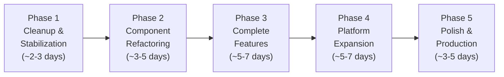

# Nova Health Platform — Complete Analysis & Improvement Strategy

## Executive Summary

**Nova Health** (codenamed "Nova-consultation") is a telemedicine web application built with **Next.js 14 App Router**, **Supabase** (PostgreSQL + Auth + Realtime + Storage), **Tailwind CSS**, and **Zoom Video SDK**. It supports English and Amharic via `next-intl`.

The codebase contains **110 source files** (~1 MB of TypeScript/JSX), **33 API routes**, **18 database tables**, and covers patient, doctor, and admin portals. The core consultation flow (queue → waiting room → video call → clinical notes → review) is substantially built.

> [!WARNING]
> The project suffers from **significant accumulated technical debt**: duplicated components, inconsistent branding, dead code, bloated page files, schema/type mismatches, and several broken links and routing bugs. These issues must be resolved before adding new features.

---

## Part 1: Current State Assessment

### 1.1 What Works Well ✅

| Area | Assessment |
|------|-----------|
| **Database schema** | Well-designed 18-table PostgreSQL schema with proper foreign keys, RLS policies, triggers (auto-rating aggregation, video room name generation, doctor-available notifications), and realtime publication |
| **API layer** | 33 clean REST API routes with consistent patterns (admin client for server ops, proper error handling) |
| **Server query layer** | Well-organized `lib/server/` with separated concerns (`queries.ts`, `doctor-queries.ts`, `admin-queries.ts`) |
| **Supabase Realtime** | Comprehensive realtime subscriptions for queue, chat, notifications, doctor status, and user presence |
| **Consultation flow** | End-to-end queue → waiting room → Zoom video → chat → clinical notes → review pipeline is functional |
| **Type system** | Clean domain types in `lib/types.ts` covering all core entities |
| **Client API layer** | `lib/api.ts` provides clean typed fetch wrappers for all endpoints |
| **Auth system** | Proper Supabase Auth with role-based routing (patient/doctor/admin), service-role signup flow |
| **Design tokens** | Comprehensive Tailwind config with custom colors, animations, shadows, and gradients |

### 1.2 Critical Issues 🔴

#### A. Massive Bloated Page Files
Several page files are unreasonably large because they contain inline component definitions, duplicate logic, and hardcoded data instead of importing shared components:

| File | Size | Problem |
|------|------|---------|
| [`consultations/page.tsx`](file:///C:/Users/DELL%207020/Nova-consultation/app/consultations/page.tsx) | **70.8 KB** | Largest file — contains entire consultation hub with inline components |
| [`doctor/[id]/page.tsx`](file:///C:/Users/DELL%207020/Nova-consultation/app/doctor/%5Bid%5D/page.tsx) | **55.5 KB** | Doctor profile with inline queue, review, reminder logic |
| [`doctor-dashboard/consult/page.tsx`](file:///C:/Users/DELL%207020/Nova-consultation/app/doctor-dashboard/consult/page.tsx) | **50 KB** | Doctor consultation room with inline everything |
| [`doctor-dashboard/feed/page.tsx`](file:///C:/Users/DELL%207020/Nova-consultation/app/doctor-dashboard/feed/page.tsx) | **43.5 KB** | Blog feed with inline post card, editor, comments |
| [`meeting/MeetingRoom.tsx`](file:///C:/Users/DELL%207020/Nova-consultation/app/meeting/MeetingRoom.tsx) | **42 KB** | Meeting room component |
| [`page.tsx`](file:///C:/Users/DELL%207020/Nova-consultation/app/page.tsx) (landing) | **38.9 KB** | Landing page with hardcoded mock doctors/blogs |
| [`doctor-dashboard/history/page.tsx`](file:///C:/Users/DELL%207020/Nova-consultation/app/doctor-dashboard/history/page.tsx) | **37.6 KB** | Consultation history |
| [`ZoomVideoCall.jsx`](file:///C:/Users/DELL%207020/Nova-consultation/app/components/ZoomVideoCall.jsx) | **34.1 KB** | Zoom SDK integration in plain JS |

> [!CAUTION]
> **A single page file (consultations/page.tsx) is 70.8 KB** — larger than the entire `lib/` directory combined. This makes maintenance extremely difficult.

#### B. Severe Component Duplication
Instead of importing shared components from `components/`, pages re-implement them inline:

| Component | In `components/` | Duplicated In |
|-----------|-----------------|---------------|
| **DoctorCard** | `components/ui/DoctorCard.tsx` (✅ production quality) | `app/doctors/page.tsx` (reinvented), `app/dashboard/page.tsx` (reinvented as `NormalDoctorCard`) |
| **PostCard** | `components/ui/PostCard.tsx` | `app/blog/page.tsx` (`FeedPostCard`), `app/dashboard/page.tsx` (`FeaturedPostCard`, `RelatedPostCard`), `app/doctor-dashboard/feed/page.tsx` (another `PostCard`) |
| **WaitingRoom** | `components/ui/WaitingRoom.tsx` (mock) | `app/meeting/WaitingRoom.tsx` (real — 444 lines) |
| **VideoCall** | `components/ui/VideoCall.tsx` (mock) | `app/components/ZoomVideoCall.jsx` + `app/meeting/MeetingRoom.tsx` (real) |
| **Footer** | `components/layout/Footer.tsx` | `components/ui/ModernFooter.tsx` (both rendered simultaneously!) |
| **Navbar** | `components/layout/Navbar.tsx` | `components/ui/ModernNavbar.tsx` (both rendered on `/blog`!) |

#### C. Dead / Orphaned Code
**5 of 10 components** in `components/` are completely unused:

| File | Status | Reason |
|------|--------|--------|
| [`components/ui/VideoCall.tsx`](file:///C:/Users/DELL%207020/Nova-consultation/components/ui/VideoCall.tsx) | 💀 Dead | Mock prototype, replaced by ZoomVideoCall |
| [`components/ui/WaitingRoom.tsx`](file:///C:/Users/DELL%207020/Nova-consultation/components/ui/WaitingRoom.tsx) | 💀 Dead | Mock prototype, replaced by `app/meeting/WaitingRoom.tsx` |
| [`components/ui/AppointmentCard.tsx`](file:///C:/Users/DELL%207020/Nova-consultation/components/ui/AppointmentCard.tsx) | 💀 Dead | Never imported anywhere |
| [`components/ui/OnboardingGuide.tsx`](file:///C:/Users/DELL%207020/Nova-consultation/components/ui/OnboardingGuide.tsx) | 💀 Dead | Never imported; DOM selectors don't exist |
| [`components/ui/PostCard.tsx`](file:///C:/Users/DELL%207020/Nova-consultation/components/ui/PostCard.tsx) | 💀 Dead | Imported in 2 files but never rendered |

Other dead code:
- [`lib/auth.ts`](file:///C:/Users/DELL%207020/Nova-consultation/lib/auth.ts) — localStorage mock auth, 0 imports (superseded by `lib/supabase/auth.ts`)
- [`lib/firebase.ts`](file:///C:/Users/DELL%207020/Nova-consultation/lib/firebase.ts) — Empty placeholder, 0 active imports
- `app/data/*.mock.disabled` — Disabled mock data files
- [`test-400.js`](file:///C:/Users/DELL%207020/Nova-consultation/test-400.js), [`test-400.mjs`](file:///C:/Users/DELL%207020/Nova-consultation/test-400.mjs), [`test-next-log.js`](file:///C:/Users/DELL%207020/Nova-consultation/test-next-log.js) — Test scripts in root
- `app/doctor-dashboard.zip` — ZIP file inside `app/` directory
- `gitignore` file (duplicate of `.gitignore`)

#### D. Branding Inconsistency ("Nova Health" vs "MediBook")
The root layout metadata says **"Nova Health"**, but components hardcode **"MediBook"**:

| Location | Brand Used |
|----------|-----------|
| `app/layout.tsx` metadata | ✅ "Nova Health" |
| `components/layout/Navbar.tsx` (logo, alt text) | ❌ "MediBook" |
| `components/ui/ModernNavbar.tsx` (export name, logo) | ❌ "MediBookNavbar" |
| `components/ui/ModernFooter.tsx` (everywhere) | ❌ "MediBook Health Technologies" |
| `app/doctor-dashboard/layout.tsx` (header) | ❌ "MediBook" |
| `app/page.tsx` (hero CTA: "Join MediBook →") | ❌ "MediBook" |
| `app/page.tsx` (CTA section: "trust MediBook") | ❌ "MediBook" |

#### E. Layout / Navigation Bugs

1. **Double footer**: `app/layout.tsx` renders `<Footer />` on every page. Landing (`/`), About, Blog, Contact pages also render `<ModernFooter />` — users see two footers stacked.
2. **Double navbar on `/blog`**: `app/blog/layout.tsx` mounts `<Navbar />`, while `app/blog/page.tsx` independently mounts `<ModernNavbar />`.
3. **Broken relative link**: `Navbar.tsx` line 58 uses `href: "blog"` (relative) instead of `"/blog"`. On nested routes like `/doctors/123`, clicking "Blogs" navigates to `/doctors/blog` (404).
4. **Dead notification badge**: `Navbar.tsx` checks `href === "/appointments"` but the nav uses `/consultations` — badge never shows.
5. **ModernNavbar dead links**: "Consultation" and "Doctors" both point to `/doctors`; "Health Plans" → `/plans` (404); "Blogs" → `/blogs` (should be `/blog`).
6. **ModernFooter 10+ dead links**: `/plans`, `/blogs`, `/records`, `/doctor/signup`, `/doctor/resources`, `/clinics`, `/careers`, `/press`, `/help`, `/privacy`, `/terms`, `/cookies` — none exist.
7. **ModernNavbar ignores auth**: Always shows "Sign In" even when user is logged in.
8. **Landing page links to `/signup`** — route doesn't exist (should be `/login`).

#### F. Database / Schema Issues

1. **Schema out of sync**: `fresh_database.sql` doesn't include structured notes columns (`diagnosis`, `prescription`, etc.) added by `add_structured_notes.sql`. Running only the baseline breaks API routes that query these columns.
2. **TypeScript types outdated**: `database.types.ts` is missing `blog_bookmarks` table, `profile_picture` column, and all structured note columns. Code uses `as any` / `as never` to bypass.
3. **Migration runner broken**: `run_migration.mjs` imports `pg` which isn't in `package.json`, and only runs `fresh_database.sql` (misses 3 other migration files).
4. **RLS out of sync**: `fresh_database.sql` message policies don't include `sender_id` check — users can't see their own sent messages until `fix_messaging_migration.sql` is applied.
5. **Unused DB function**: `recalculate_queue_positions()` exists but is never called — queue positions are calculated manually in JS with potential gaps.
6. **Storage bucket conflict**: README says `chat-attachments` should be private (signed URLs), but `upload/route.ts` creates it as public.
7. **Outdated docs**: `supabase/README.md` references deleted migration files.

#### G. Dependency Issues

| Package | Problem |
|---------|---------|
| `firebase` | Installed but completely unused (placeholder code) |
| `express` + `cors` | Installed but not used — Next.js API routes handle everything |
| `dotenv` | Installed but Next.js handles env vars natively |
| `pg` | Referenced in `run_migration.mjs` but NOT installed |
| `next-intl` | Configured but i18n routing not actually implemented (no locale prefix in routes) |

#### H. Styling Inconsistencies

- **Patient portal** uses navy `#1a3558` + teal `#0cbcad` palette
- **Doctor dashboard** uses a completely different blue `#003580` + `#0071c2` + `#38bdf8` palette
- **ZoomVideoCall** uses Slate `#0f172a` + Indigo `#6366f1`
- Mixing of Tailwind utilities, inline `style={{}}`, custom CSS classes (`.glass-card`), and styled-jsx (`<style jsx>`)

### 1.3 Completeness Assessment

| Area | Status | Details |
|------|--------|---------|
| **Landing page** | 🟡 ~80% | Hero, specialties, doctors, how-it-works, blog preview, CTA — all with hardcoded mock data. Many dead links. Double footer. |
| **Patient auth** | 🟢 ~90% | Login + signup with role selection works. Missing: forgot password, email verification UX. |
| **Doctor auth** | 🟢 ~90% | Dedicated doctor login/register with credentials. Missing: forgot password. |
| **Admin auth** | 🟢 ~85% | Admin login with verification. Missing: proper session management. |
| **Doctor directory** | 🟢 ~90% | Filtering, search, status display, queue joining. Uses inline DoctorCard instead of shared. |
| **Doctor profile** | 🟢 ~85% | Full profile, reviews, queue status, remind-me. Very bloated single file. |
| **Patient dashboard** | 🟡 ~75% | Shows doctors and posts. Missing: active consultation display, proper stats, quick actions. |
| **Patient messages** | 🟢 ~85% | Conversation list + real-time chat with doctors. Working but complex. |
| **Consultation flow** | 🟢 ~85% | Queue → waiting room → video → chat → end. Core flow works. |
| **Video call (patient)** | 🟢 ~80% | Zoom SDK integration with chat, reconnection handling. Needs stability testing. |
| **Video call (doctor)** | 🟢 ~80% | Full consult room with clinical notes, prescriptions. Very large file. |
| **Doctor dashboard** | 🟡 ~75% | Queue management, status toggle, stats. Missing: revenue analytics, patient trends. |
| **Doctor messages** | 🟢 ~85% | Direct messaging with patients. |
| **Doctor schedule** | 🟡 ~70% | Weekly availability management. Missing: break times, holiday blocks. |
| **Doctor profile mgmt** | 🟢 ~85% | Edit specialty, bio, fee, languages, photo upload. |
| **Doctor feed/blog** | 🟡 ~75% | Create/edit articles. Missing: proper content editor, image upload for posts. |
| **Follow-ups** | 🟡 ~70% | Create/view follow-ups. Missing: reminder automation, calendar integration. |
| **Consultation history** | 🟢 ~85% | Both patient and doctor can view past consultations with notes. |
| **Reviews** | 🟢 ~85% | Post-consultation rating + review. Auto-aggregated to doctor profile. |
| **Notifications** | 🟢 ~80% | Realtime + polling. Multiple types. Missing: push notifications, email. |
| **Admin dashboard** | 🟡 ~60% | Basic stats, user management, doctor verification. Missing: content moderation, analytics, reports. |
| **Blog / health feed** | 🟡 ~70% | Post listing, likes, comments, bookmarks. Missing: search, categories page, proper SEO. |
| **About page** | 🟢 ~90% | Comprehensive with mission, values, team. All hardcoded. |
| **Contact page** | 🟢 ~85% | Form + Ethiopian contact details. Form doesn't actually submit. |
| **Saved doctors** | 🟢 ~90% | Save/unsave, list with status. |
| **Remind Me** | 🟢 ~85% | Subscribe to offline doctor, auto-notification when available. |
| **i18n** | 🔴 ~20% | next-intl configured but locale routing not implemented. EN/AM JSON files exist but barely used. |
| **Mobile responsiveness** | 🟡 ~75% | Most pages have mobile layouts. Navbar has mobile bottom bar. Some pages untested. |

---

## Part 2: Improvement Strategy

### 2.1 Guiding Principles

1. **Fix before you build** — Resolve all broken/inconsistent behavior before adding features
2. **Simplify, don't rewrite** — Refactor incrementally; keep what works
3. **Extract, don't duplicate** — Move inline components to shared `components/`
4. **One source of truth** — Consolidate schema, types, branding, styling
5. **Minimal disruption** — Changes should not break existing working flows

### 2.2 Phased Execution Plan

---

### Phase 1: Cleanup & Stabilization (Foundation)
*Goal: Remove dead code, fix all bugs, consolidate branding, and make the project build cleanly.*

#### 1A. Delete Dead Code & Artifacts
- [ ] Delete `components/ui/VideoCall.tsx` (mock, replaced by Zoom)
- [ ] Delete `components/ui/WaitingRoom.tsx` (mock, replaced by `app/meeting/WaitingRoom.tsx`)
- [ ] Delete `components/ui/AppointmentCard.tsx` (0 usages)
- [ ] Delete `components/ui/OnboardingGuide.tsx` (0 usages, broken selectors)
- [ ] Delete `lib/auth.ts` (localStorage mock, 0 imports)
- [ ] Delete `lib/firebase.ts` (empty placeholder, 0 imports)
- [ ] Delete `test-400.js`, `test-400.mjs`, `test-next-log.js` (test artifacts)
- [ ] Delete `app/doctor-dashboard.zip` (archive file in app directory)
- [ ] Delete `gitignore` (duplicate of `.gitignore`)
- [ ] Delete `app/data/*.mock.disabled` files
- [ ] Remove unused imports from all files (lucide icons, etc.)

#### 1B. Fix Branding — "Nova Health" Everywhere
- [ ] Rename `ModernNavbar` export from `MediBookNavbar` → `ModernNavbar`
- [ ] Replace all "MediBook" strings with "Nova Health" across Navbar, ModernNavbar, ModernFooter, doctor-dashboard layout, landing page
- [ ] Update email `support@medibook.health` → `support@novahealth.com`
- [ ] Update company name "MediBook Health Technologies" → "Nova Health Technologies"

#### 1C. Fix Layout Conflicts
- [ ] **Double footer fix**: Remove `<Footer />` from `app/layout.tsx`. Instead, conditionally render the appropriate footer per route. OR: remove `<ModernFooter />` from pages and enhance the shared `Footer` component.
- [ ] **Double navbar fix**: Remove `<ModernNavbar />` from `app/blog/page.tsx` (layout already provides `Navbar`).
- [ ] **Fix `Navbar.tsx` relative link**: Change `href: "blog"` → `href: "/blog"` (line 58)
- [ ] **Fix dead notification badge**: Change `href === "/appointments"` → `href === "/consultations"`
- [ ] **Fix ModernNavbar dead links**: "Blogs" → `/blog`, "Health Plans" → remove or link to valid page, deduplicate "Consultation" / "Doctors"
- [ ] **Fix ModernFooter dead links**: Remove or create placeholder pages for `/plans`, `/records`, `/doctor/signup`, `/careers`, `/press`, `/help`, `/privacy`, `/terms`, `/cookies`
- [ ] **Fix ModernNavbar auth awareness**: Check session state and show appropriate links
- [ ] **Fix landing page CTA links**: `/signup` → `/login`, `/doctor/signup` → `/doctor-login`

#### 1D. Fix Database & Schema Issues
- [ ] **Consolidate `fresh_database.sql`**: Merge `add_structured_notes.sql`, `add_profile_picture.sql`, and `fix_messaging_migration.sql` into the baseline schema so a single file creates a complete, correct database
- [ ] **Regenerate `database.types.ts`**: Add missing `blog_bookmarks` table, `profile_picture` column, and all structured notes columns
- [ ] **Fix `run_migration.mjs`**: Either remove it (manual SQL execution is fine) or fix to run all migration files in order
- [ ] **Remove `pg` import or add to devDependencies**
- [ ] **Fix storage bucket policy**: Decide private or public for `chat-attachments` and align code + docs
- [ ] **Wire up `recalculate_queue_positions()`**: Either call it from API routes on queue changes, or remove the function
- [ ] **Update `supabase/README.md`**: Reflect current file structure

#### 1E. Clean Up Dependencies
- [ ] Remove `firebase` from `package.json`
- [ ] Remove `express` and `cors` from `package.json`
- [ ] Remove `dotenv` from `package.json` (Next.js handles this)
- [ ] Add `pg` to `devDependencies` if keeping `run_migration.mjs`

---

### Phase 2: Component Extraction & Refactoring
*Goal: Extract inline components from bloated pages into shared reusable components. Dramatically reduce page file sizes.*

#### 2A. New Component Architecture
```
components/
├── layout/
│   ├── Navbar.tsx          (unified: auth-aware, handles both public & patient views)
│   ├── Footer.tsx          (unified: comprehensive footer for all pages)
│   ├── DoctorSidebar.tsx   (extracted from doctor-dashboard/layout.tsx)
│   └── AdminSidebar.tsx    (extracted from admin-dashboard/layout.tsx)
├── ui/
│   ├── DoctorCard.tsx      (existing — adopt everywhere)
│   ├── PostCard.tsx        (refactored — remove mocks, accept dynamic data)
│   ├── ConsultationCard.tsx (new — extracted from consultations/page.tsx)
│   ├── QueueCard.tsx       (new — extracted from doctor-dashboard/page.tsx)
│   ├── PatientCard.tsx     (new — extracted from doctor-dashboard/patients)
│   ├── ReviewCard.tsx      (new — extracted from doctor/[id]/page.tsx)
│   ├── NotificationItem.tsx (new — deduplicate from 3 notification UIs)
│   ├── ChatPanel.tsx       (new — extracted from MeetingRoom + messages pages)
│   ├── StatusBadge.tsx     (new — unified status display)
│   └── StatCard.tsx        (new — reusable stats display)
├── video/
│   ├── ZoomVideoCall.tsx   (moved from app/components/, converted to TS)
│   ├── MeetingRoom.tsx     (moved from app/meeting/)
│   └── WaitingRoom.tsx     (moved from app/meeting/)
└── forms/
    ├── LoginForm.tsx       (extracted from login/page.tsx)
    ├── SignupForm.tsx      (extracted from login/page.tsx)
    └── ContactForm.tsx     (extracted from contact/page.tsx)
```

#### 2B. Page Refactoring Priority (by file size)
1. **`consultations/page.tsx`** (70.8 KB → target: ~15 KB) — Extract ConsultationCard, QueueDisplay, WaitingPanel, HistoryList
2. **`doctor/[id]/page.tsx`** (55.5 KB → target: ~12 KB) — Extract ReviewCard, QueueStatus, RemindButton, DoctorInfo
3. **`doctor-dashboard/consult/page.tsx`** (50 KB → target: ~15 KB) — Extract ClinicalNotesForm, ConsultChat, PatientInfo
4. **`doctor-dashboard/feed/page.tsx`** (43.5 KB → target: ~10 KB) — Extract PostEditor, PostCard (shared)
5. **`page.tsx` landing** (38.9 KB → target: ~8 KB) — Extract HeroSection, SpecialtiesGrid, DoctorGrid, BlogPreview, CTABanner
6. **`doctor-dashboard/history/page.tsx`** (37.6 KB → target: ~8 KB) — Use shared ConsultationCard
7. **`dashboard/page.tsx`** (27.2 KB → target: ~8 KB) — Use shared DoctorCard, PostCard

#### 2C. Convert ZoomVideoCall to TypeScript
- Move `app/components/ZoomVideoCall.jsx` → `components/video/ZoomVideoCall.tsx`
- Add proper TypeScript types for all props and Zoom SDK events
- Replace inline `<style jsx>` with Tailwind classes

#### 2D. Unify Color Palette
Define a single design system palette and use it everywhere:
```
Patient portal:  primary-600 (#1a3558) + teal-500 (#0cbcad)
Doctor portal:   primary-600 (#1a3558) + teal-500 (#0cbcad)  ← align to same palette
Admin portal:    primary-600 (#1a3558) + teal-500 (#0cbcad)  ← align to same palette
```
Replace all inline `style={{ background: "#003580" }}` with Tailwind tokens.

---

### Phase 3: Complete Unfinished Features
*Goal: Fill gaps in existing functionality to make each portal production-ready.*

#### 3A. Landing Page Completion
- [ ] Fetch featured doctors from API instead of hardcoded `DOCTORS` array
- [ ] Fetch blog previews from API instead of hardcoded `BLOGS` array
- [ ] Add real search functionality (wire search bar to `/doctors?q=...`)
- [ ] Add testimonials section with real reviews from database
- [ ] Create missing legal pages (`/privacy`, `/terms`) — even if placeholder
- [ ] Create `/signup` redirect to `/login` with signup tab active

#### 3B. Patient Portal Completion
- [ ] Enhance patient dashboard with active consultation status, upcoming follow-ups, health stats
- [ ] Add "Forgot Password" flow to login
- [ ] Complete consultation history with downloadable summaries
- [ ] Add patient onboarding flow (medical history, emergency contact setup)
- [ ] Improve mobile bottom navigation with proper route highlighting

#### 3C. Doctor Portal Completion
- [ ] Add revenue/earnings analytics to doctor dashboard
- [ ] Add patient trends and consultation statistics charts
- [ ] Improve schedule management with break times and holiday blocks
- [ ] Add rich text editor for blog post creation
- [ ] Add image upload for blog posts
- [ ] Improve follow-up management with automated reminders

#### 3D. Admin Dashboard Completion
- [ ] Add consultation monitoring (active sessions, average wait times)
- [ ] Add content moderation tools (blog posts, reviews)
- [ ] Add revenue reporting and platform analytics
- [ ] Add system health monitoring
- [ ] Add admin activity logs
- [ ] Implement proper role-based admin permissions

#### 3E. Chat & Video Stability
- [ ] Add connection quality indicator for video calls
- [ ] Add reconnection UI/UX when connection drops
- [ ] Add message delivery status indicators (sent/delivered/read)
- [ ] Add typing indicators in chat
- [ ] Test and fix edge cases: simultaneous queue joining, browser refresh during call, etc.

---

### Phase 4: Platform Expansion — Beyond Telemedicine
*Goal: Evolve from doctor-only to a broader healthcare & wellness professional platform.*

#### 4A. Data Model Changes

The database already includes `user_role` enum with `'professional'` value, and `doctor_profiles` can be generalized. Strategy:

**Option A (Recommended): Rename & Generalize**
- Rename `doctor_profiles` → `provider_profiles` (or add a view/alias)
- Add `provider_type` column: `'doctor'`, `'fitness_trainer'`, `'nutritionist'`, `'therapist'`, `'wellness_coach'`, etc.
- Add `credentials` JSONB column for flexible credential storage per type
- Add `services` JSONB column for listing specific services offered
- Keep `specialty`, `fee`, `rating`, `status`, `is_verified` — they apply to all providers
- Rename `consultation_type` values to include `'in_person'`, `'video'`, `'messaging'`, `'hybrid'`

**Option B: Separate Tables Per Type** — Not recommended (too much schema duplication)

#### 4B. UI / Route Changes for Multi-Provider Support
- Rename user-facing "Doctor" labels to "Provider" or "Professional" where appropriate
- Update landing page specialties to include wellness categories
- Update search/filter to include provider type
- Update doctor directory to become "Provider Directory"
- Keep separate registration flows per provider type (credentials differ)
- Add provider-type-specific dashboard customizations

#### 4C. Provider Types to Support

| Type | Specialty Examples | Session Types |
|------|-------------------|---------------|
| **Medical Doctor** | Cardiology, Neurology, Pediatrics, etc. | Video, In-person |
| **Mental Health** | Psychology, Psychiatry, Counseling | Video, Messaging |
| **Nutritionist** | Clinical Nutrition, Sports Nutrition, Diet Planning | Video, Messaging |
| **Fitness Professional** | Personal Training, Yoga, Physiotherapy | Video, In-person |
| **Wellness Coach** | Life Coaching, Stress Management, Sleep | Video, Messaging |

#### 4D. New Features for Expanded Platform
- [ ] Provider-type-specific onboarding flows
- [ ] Category-based browse pages (Medical, Mental Health, Nutrition, Fitness, Wellness)
- [ ] Service packages (one-time vs recurring sessions)
- [ ] Group sessions support (fitness classes, group therapy)
- [ ] Content categories for blog (health, fitness, nutrition, mental health, wellness)
- [ ] Provider certification verification workflows per type

---

### Phase 5: Polish & Production Readiness
*Goal: Prepare for production deployment.*

- [ ] Implement proper i18n routing with locale prefixes or accept-language detection
- [ ] Add error boundaries and proper error pages (404, 500)
- [ ] Add loading skeletons for all data-fetching pages
- [ ] Add SEO meta tags to all pages
- [ ] Add proper form validation across all forms
- [ ] Set up ESLint rules and fix all warnings
- [ ] Add basic end-to-end tests for critical flows
- [ ] Set up CI/CD pipeline
- [ ] Performance optimization (image optimization, code splitting, lazy loading)
- [ ] Security audit (input sanitization, rate limiting, CORS)
- [ ] Accessibility audit (ARIA labels, keyboard navigation, screen reader)

---

## Part 3: Recommended Execution Order

> [!IMPORTANT]
> Start with Phase 1 (Cleanup). Each subsequent phase depends on the previous being complete.



> [!TIP]
> **Phases 1 and 2 are the highest priority.** They involve zero new features but will dramatically improve maintainability. The codebase will go from ~1 MB of tangled code to a well-organized, maintainable structure. This makes Phases 3-5 much faster and less error-prone.

---

## Part 4: File-by-File Impact Summary

### Files to DELETE (Phase 1A)
| File | Reason |
|------|--------|
| `components/ui/VideoCall.tsx` | Dead mock, replaced by ZoomVideoCall |
| `components/ui/WaitingRoom.tsx` | Dead mock, replaced by app/meeting/WaitingRoom |
| `components/ui/AppointmentCard.tsx` | Zero usages anywhere |
| `components/ui/OnboardingGuide.tsx` | Zero usages, broken selectors |
| `lib/auth.ts` | Dead localStorage auth |
| `lib/firebase.ts` | Empty placeholder |
| `test-400.js`, `test-400.mjs`, `test-next-log.js` | Test artifacts |
| `app/doctor-dashboard.zip` | Archive file in source |
| `gitignore` | Duplicate of `.gitignore` |
| `run_migration.mjs` | Broken (missing `pg` dep), incomplete |
| `app/data/*.mock.disabled` | Disabled mock files |

### Files to HEAVILY REFACTOR (Phase 2)
| File | Current | Target | Extraction |
|------|---------|--------|------------|
| `app/consultations/page.tsx` | 70.8 KB | ~15 KB | 4-5 components out |
| `app/doctor/[id]/page.tsx` | 55.5 KB | ~12 KB | 3-4 components out |
| `app/doctor-dashboard/consult/page.tsx` | 50 KB | ~15 KB | 3-4 components out |
| `app/doctor-dashboard/feed/page.tsx` | 43.5 KB | ~10 KB | 2-3 components out |
| `app/page.tsx` | 38.9 KB | ~8 KB | 5-6 sections out |
| `app/doctor-dashboard/history/page.tsx` | 37.6 KB | ~8 KB | 2-3 components out |
| `app/dashboard/page.tsx` | 27.2 KB | ~8 KB | Use shared components |
| `app/components/ZoomVideoCall.jsx` | 34.1 KB JS | 30 KB TS | Convert + move |

### Files to FIX (Phase 1)
| File | Fixes Needed |
|------|-------------|
| `components/layout/Navbar.tsx` | Relative link, branding, dead badge, unused imports/state |
| `components/ui/ModernNavbar.tsx` | Dead links, auth awareness, branding |
| `components/ui/ModernFooter.tsx` | Dead links, branding |
| `app/layout.tsx` | Double footer |
| `app/doctor-dashboard/layout.tsx` | Branding |
| `supabase/fresh_database.sql` | Merge migration columns |
| `lib/supabase/database.types.ts` | Regenerate with missing columns/tables |
| `supabase/README.md` | Update references |
| `package.json` | Remove unused deps |
